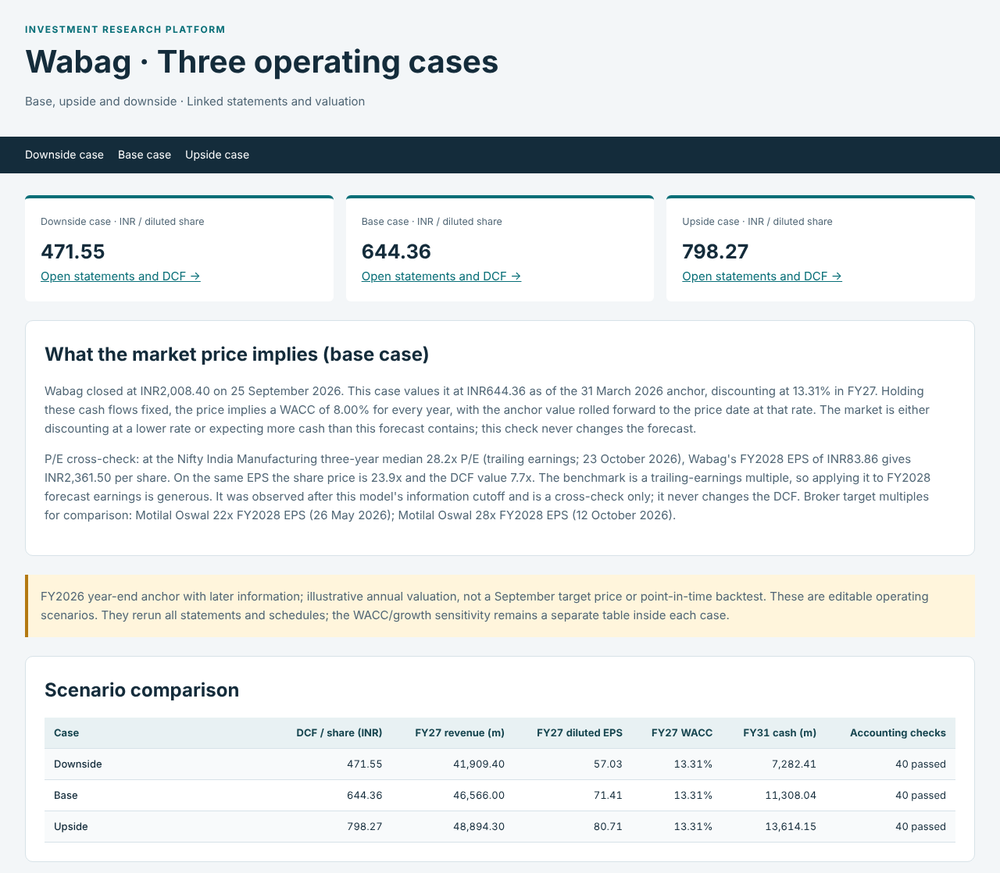
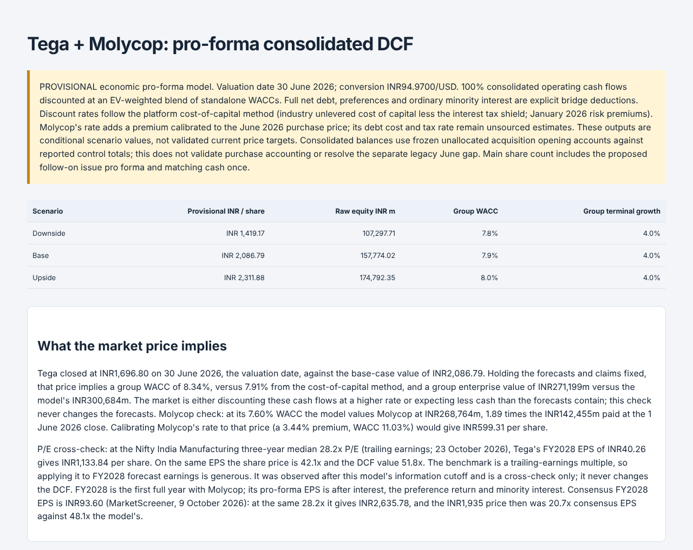
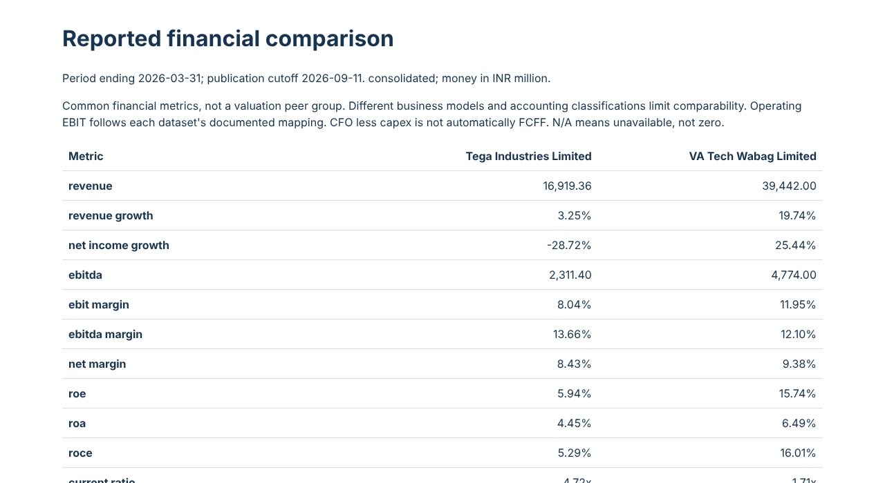
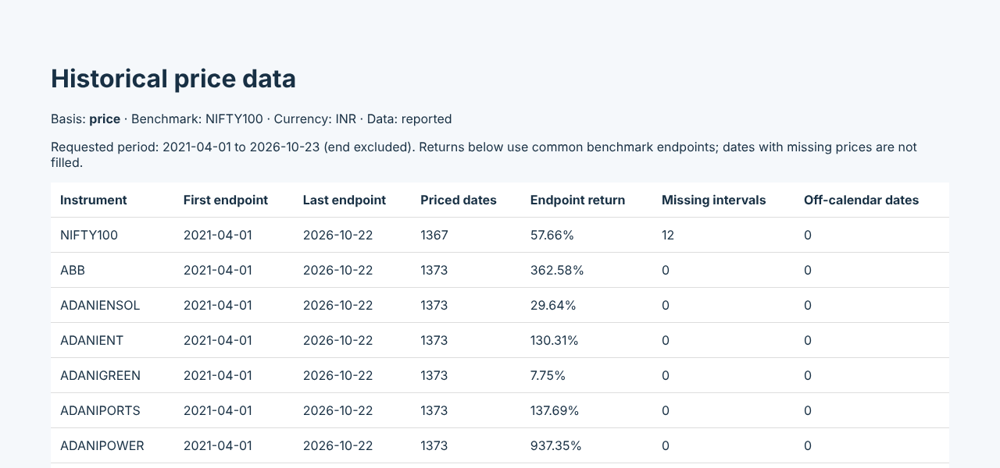
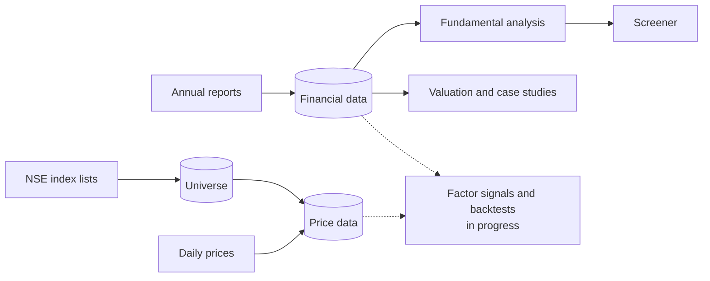

# Indian Equity Research & Quantitative Analytics Platform

[](https://github.com/tanaymkr/Equity-Research-Quantitative-Portfolio-Analytics-Platform/actions/workflows/ci.yml)


A Python and SQLite platform for fundamental and quantitative research on
Indian listed equities. It combines point-in-time financial data, linked
three-statement models and DCF valuations of two NSE-listed companies, a
fundamental screener, and a Nifty 100 research universe with five and a half
years of audited daily prices. It is the foundation for factor research and
backtesting, which are in progress.

Built by [Tanay Malekar](https://github.com/tanaymkr).

## Highlights

- **Tega Industries + Molycop acquisition model.** Pro-forma consolidated
  DCF built on Tega's audited FY2026 statements (92 reconciliation checks),
  with a blended WACC, an explicit preference / minority / dilution equity
  bridge and three scenarios.
- **VA Tech Wabag linked three-statement model.** FY2027–FY2031 income
  statement, balance sheet and cash flow with debt, asset, tax,
  working-capital and equity schedules; 40 accounting checks per scenario;
  FCFF DCF with dated market inputs.
- **One cost of capital, checked against the market.** Every DCF uses the
  same method: an industry unlevered cost of capital less the interest tax
  shield, with India risk premiums (Damodaran, January 2026). Each report also solves
  for the discount rate the share price implies and shows a P/E cross-check,
  rather than tuning forecasts to match the market
  ([method and results](docs/COST_OF_CAPITAL.md)).
- **Point-in-time financial data.** Every filing version is stored with its
  publication date, so a query reconstructs what was public on any date
  rather than what is known today.
- **Nifty 100 research universe.** Index membership stored as dated,
  immutable lists with a guard against survivorship bias; daily prices for
  all 100 members and the index from April 2021.
- **Data-quality auditing.** Automated calendar checks and an audit of the
  vendor data that found unadjusted demergers, a mis-dated split and
  placeholder rows on market holidays ([findings](docs/guides/universe.md#price-data-problems-found-in-the-first-nifty-100-download)).
- **Tested.** 320 automated tests run in continuous integration on every push.

## Screenshots

<table>
  <tr>
    <td width="50%"><br><sub>Wabag: three operating cases from the linked statements and DCF</sub></td>
    <td width="50%"><br><sub>Tega + Molycop: pro-forma consolidated DCF</sub></td>
  </tr>
  <tr>
    <td width="50%"><br><sub>Point-in-time comparison of reported fundamentals</sub></td>
    <td width="50%"><br><sub>Nifty 100 price coverage against the NIFTY 100 benchmark</sub></td>
  </tr>
</table>

## Status

| Area | Status | What exists |
| --- | --- | --- |
| Financial data (SQL) | ✅&nbsp;Done | Filing versions, publication dates, as-of queries, ingestion audit trail |
| Fundamental analysis | ✅&nbsp;Done | Growth, margins, ROE/ROA/ROCE, liquidity, leverage, cash conversion, company comparison |
| Valuation | ✅&nbsp;Done | Generic FCFF DCF, shared cost-of-capital method, market-implied WACC, scenarios, sensitivity; Tega and Wabag case studies |
| Screening | ✅&nbsp;Done | Configurable filters on dated fundamentals |
| Price data | ✅&nbsp;Done | Immutable price snapshots, corporate actions, benchmark-calendar returns |
| Research universe | ✅&nbsp;Done | Nifty 100 dated membership, company master, survivorship guard |
| Factor signals | 🔜&nbsp;Next | Momentum first, then value, quality and growth |
| Backtesting | ⏳&nbsp;Planned | Information coefficient, decile portfolios, costs, out-of-sample tests |
| Portfolio and risk analytics | ⏳&nbsp;Planned | Performance statistics, VaR / Expected Shortfall, stress tests |
| Index construction | ⏳&nbsp;Planned | Selection, weighting, rebalancing, tracking |
| Streamlit interface | ⏳&nbsp;Planned | Front end over the tested modules |

Details in the [roadmap](docs/ROADMAP.md).

## How it fits together



Three separate SQLite databases hold financial statements, index membership
and prices. Each records when every fact became known, and nothing stored is
ever overwritten. See [the architecture](docs/PLATFORM_ARCHITECTURE.md).

## Quick start

Requires Python 3.11 or later. There are no third-party runtime packages.

```bash
git clone https://github.com/tanaymkr/Equity-Research-Quantitative-Portfolio-Analytics-Platform.git
cd Equity-Research-Quantitative-Portfolio-Analytics-Platform

python scripts/run_company_analysis.py   # load statements into SQL, analyse Tega and Wabag
python scripts/run_wabag_forecast.py     # Wabag linked statements and DCF
python scripts/run_tega_model.py         # Tega + Molycop acquisition model
python scripts/run_screener.py           # fundamental screener
```

Reports are written to `outputs/` (not committed). Reference copies of the
Tega model output are in [`examples/tega_molycop_reports/`](examples/tega_molycop_reports/).

The research universe and prices need an internet connection:

```bash
python scripts/run_universe.py --download
python scripts/run_price_pipeline.py --download --config outputs/universe/NIFTY100/market_config.json --output outputs/prices/NIFTY100
```

On Windows, each step also has a double-click launcher in `scripts/`
(`Run_Company_Analysis.bat`, `Run_Wabag_Forecast.bat`, `Run_Tega_Model.bat`,
`Run_Screener.bat`, `Run_Universe.bat`, `Run_Universe_Prices.bat`,
`Run_Price_Pipeline.bat`). Each opens its report when it finishes.

### Development

```bash
python -m venv .venv
source .venv/bin/activate          # Windows: .venv\Scripts\activate
python -m pip install -e ".[dev]"
python -m pytest
python -m ruff check .
```

## Repository layout

```text
src/equity_analytics/
  data/          financial-statement database, as-of queries, comparison
  financials/    statement contract, validation, ratios
  screening/     fundamental screener
  valuation/     generic DCF, cost of capital, sensitivity, SQL adapter
  forecasting/   linked three-statement engine
  case_studies/  tega/ (acquisition model), wabag/ (linked model)
  universe/      NSE index membership and company master
  market/        price snapshots, returns, reports
scripts/         command-line entry points and Windows launchers
examples/        sourced inputs, assumptions and reference outputs
tests/           320 automated tests
docs/            guides and method notes
notebooks/       walkthrough of the ratio engine
```

## Design decisions

- **Publication date, not period end.** Tega's FY2026 annual report was
  published on 28 August 2026, so a query as of 1 August 2026 must not see
  FY2026 figures. Queries select filings by publication date
  ([data layer](docs/DATA_LAYER.md)).
- **Survivorship guard.** Applying today's Nifty 100 to 2021 would include
  only companies that survived and grew. The universe refuses to apply a list
  to dates before it took effect unless the result is explicitly labelled
  biased ([universe](docs/guides/universe.md)).
- **Missing stays missing.** Prices and statements are never forward-filled
  or zero-filled; gaps are reported, not hidden.
- **Immutable, auditable storage.** New information becomes a new version;
  every import records the exact source bytes and their hash.
- **Assumptions are visible.** Valuation inputs record their source or are
  labelled as analyst assumptions, and each report states what is
  provisional.
- **The market is a cross-check, not a target.** Scenarios change operating
  drivers only; discount rates stay the same. Each report then asks what WACC the share
  price implies with the forecasts held fixed. At Wabag the answer is 8.0%,
  against 13.3% from the method, which shows the gap is in expected cash flows
  rather than the discount rate.

## Documentation

| Guide | Method notes |
| --- | --- |
| [Company financial analysis](docs/guides/company-analysis.md) | [Data layer](docs/DATA_LAYER.md) |
| [Wabag linked model and DCF](docs/guides/wabag-forecast.md) | [Financial-analysis conventions](docs/FINANCIAL_ANALYSIS_METHODS.md) |
| [Tega + Molycop model](docs/guides/tega-model.md) | [Code walkthrough](docs/FINANCIAL_ANALYSIS_WALKTHROUGH.md) |
| [Generic SQL DCF](docs/guides/sql-dcf.md) | [Cost of capital and market check](docs/COST_OF_CAPITAL.md) · [Wabag model methods](docs/WABAG_LINKED_MODEL.md) |
| [Screener](docs/guides/screener.md) | [Tega pro-forma consolidation](docs/TEGA_PRO_FORMA_CONSOLIDATION.md) |
| [Research universe](docs/guides/universe.md) | [Tega revenue drivers](docs/TEGA_REVENUE_DRIVERS.md) |
| [Price data](docs/guides/price-data.md) | [Tega FY2026 statements](docs/TEGA_FY2026_STATEMENTS.md) · [FY2024–25](docs/TEGA_FY2025_STATEMENTS.md) |
| | [Architecture](docs/PLATFORM_ARCHITECTURE.md) · [Roadmap](docs/ROADMAP.md) |

## Data sources

- **Financial statements:** company annual reports, transcribed with page
  references and publication dates (sources listed in each guide).
- **Index membership:** NSE's published constituent lists.
- **Prices:** Yahoo Finance's public chart endpoint, an unofficial source.
  Downloaded data is not committed to this repository.

## Limitations

- The valuations are conditional on stated assumptions, several of them
  provisional, and are not investment advice or price targets.
- Wabag's DCF (₹646) is far below its ₹2,008 share price; its working capital
  and five-year horizon are the next forecast items to review.
- Tega's DCF (₹2,087) is above its ₹1,697 valuation-date price and the
  analysts' ₹1,799 average target. It values Molycop at 1.9 times the price paid
  for it in June 2026; calibrated to that price, Tega would be worth ₹599. That
  is the largest single judgement in the valuation.
- Financial statements are loaded for two companies; the Nifty 100 universe
  has prices but not yet fundamentals.
- Index membership is recorded from October 2026. Earlier periods need
  historical lists before a backtest can be called survivorship-free.
- Vendor price history reflects later adjustments, so it is not
  point-in-time; known errors are documented and will be corrected before
  signals are built.
