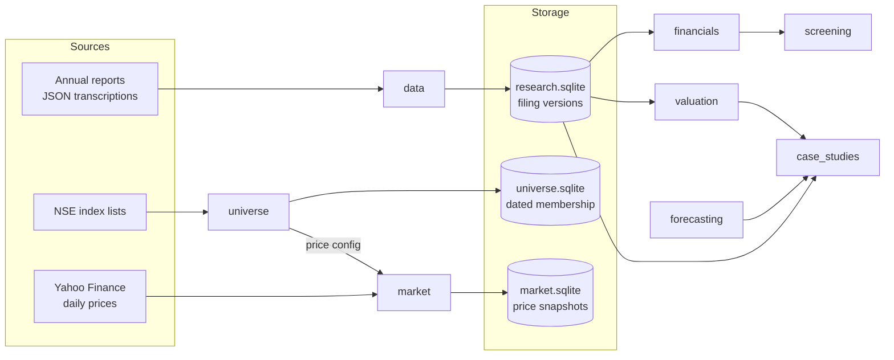

# Platform architecture

All code is in the `equity_analytics` package under `src/`. It uses only the
Python standard library (SQLite included), so it runs on any Python 3.11+
installation without third-party packages.

## Packages

| Package | Responsibility |
| --- | --- |
| `financials` | Normalized annual-statement contract, validation, ratios and reports |
| `data` | `research.sqlite`: immutable filing versions, publication dates, ingestion audit trail, as-of queries, company comparison |
| `screening` | Filters and ranks dated fundamentals; flags any zero-substituted metric without altering source data |
| `valuation` | Generic FCFF DCF, CAPM WACC, SQL-backed scenarios, equity bridge, explicit-cash-flow discounting and sensitivity |
| `forecasting` | Linked three-statement engine (consolidated, INR million; account mappings derived from Tega) |
| `case_studies.tega` | Tega + Molycop acquisition: forecasts, drivers, financing, consolidation, blended WACC, equity bridge, reports |
| `case_studies.wabag` | Wabag linked statements, schedules, annual WACC and scenarios |
| `universe` | NSE constituent parsing, dated membership in `universe.sqlite`, survivorship guard, company master, price-config export |
| `market` | `market.sqlite`: immutable price snapshots, corporate actions, Yahoo adapter, benchmark-calendar returns and reports |

`cli.py` runs the original standalone DCF demonstration
(`examples/demo_dcf.json`).

## Design rules

- **Dates are explicit.** Financial facts carry a publication date separate
  from the period end; index lists carry an effective date; price snapshots
  carry a retrieval time. Queries select by these dates, never by load order.
- **Stored records are immutable.** A changed filing, list or price history is
  stored as a new version; nothing is silently overwritten. Re-imports are
  idempotent and failed imports roll back.
- **Missing stays missing.** Prices and statements are never forward-filled or
  zero-filled. The screener's zero substitution is the one deliberate,
  flagged exception, applied at its output boundary.
- **Company-specific code stays in `case_studies`.** The generic DCF does not
  import either case study. The Tega statement adapter rejects other
  companies; new companies use the normalized schema.
- **Separate databases.** Financial, universe and price data live in separate
  SQLite files, so a schema change in one cannot corrupt another.

Storage details: [data layer](DATA_LAYER.md), [price data](guides/price-data.md),
[research universe](guides/universe.md).

## Planned flow

As-of queries feed fundamentals and price signals; dated signals feed
strategy and index construction; portfolio and risk functions consume
holdings, prices and trades; a Streamlit interface calls these functions and
owns no financial calculations. See the [roadmap](ROADMAP.md).
